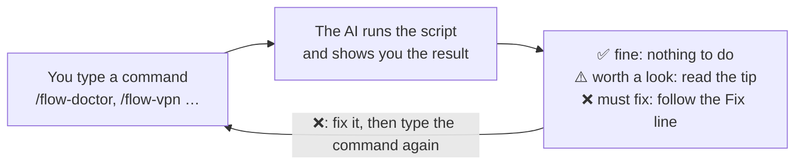
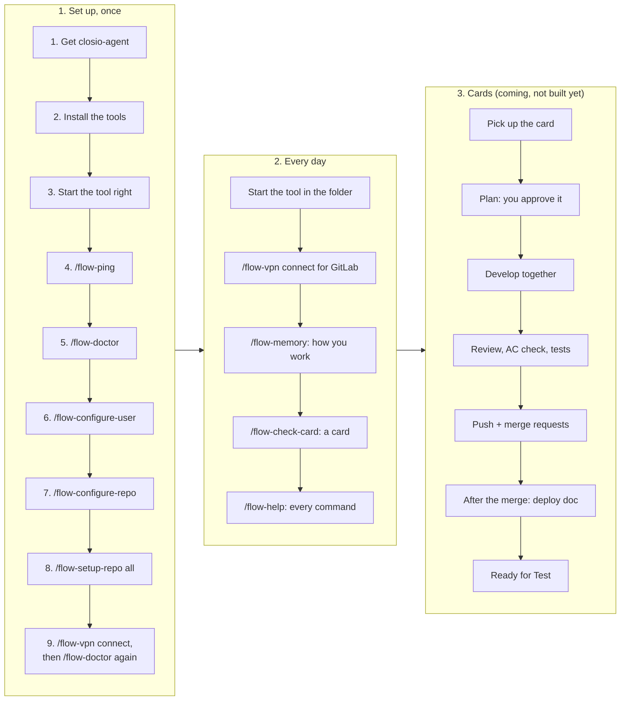
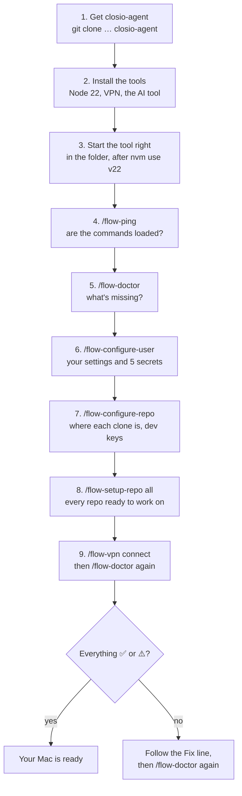
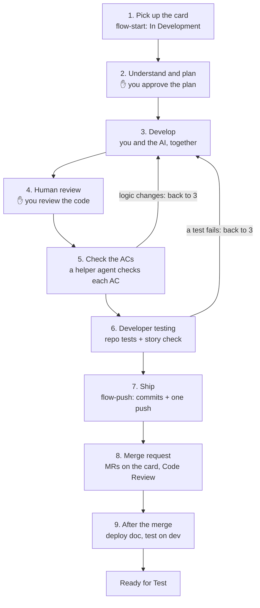
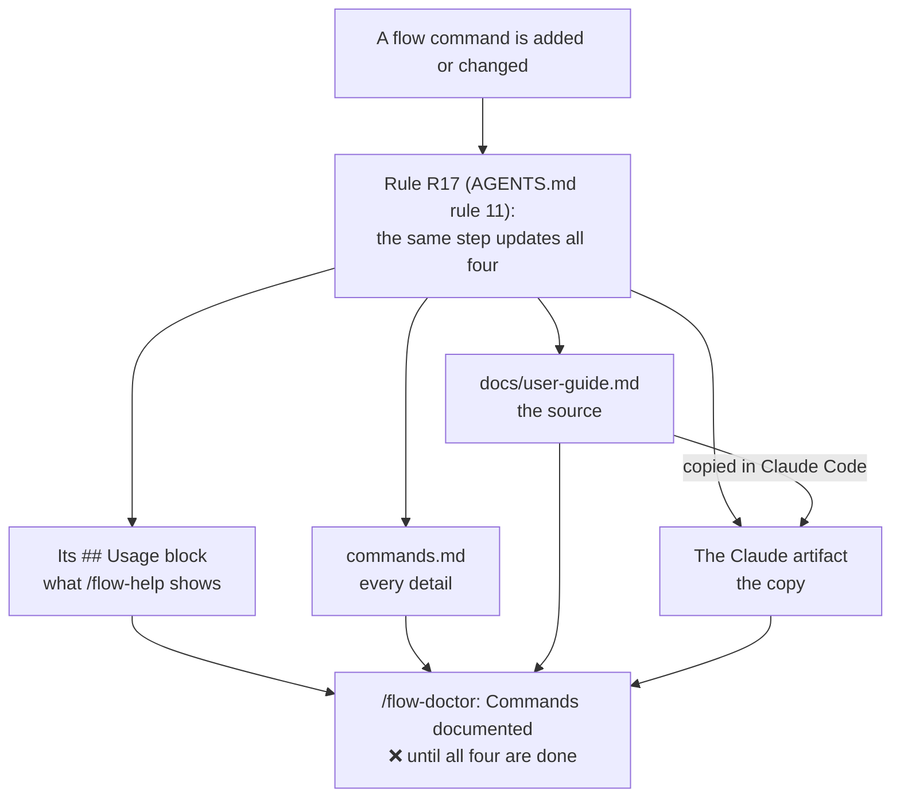

# closio-agent, step by step

**Claude artifact:** https://claude.ai/code/artifact/a83b1e2a-0e5a-4378-b791-26b9f34e8b7a · mirrored on 2026-10-17 · commands: flow-check-card, flow-configure-repo, flow-configure-user, flow-doctor, flow-help, flow-memory, flow-ping, flow-setup-repo, flow-vpn

This guide walks you through closio-agent from the first minute: which command to type, in what order, what each one asks you, and what you get back. It's written for anyone on the team, even if you've never used an AI tool before.

This file is the source and holds the full text. The Claude artifact linked above shows the same information as pictures with less text, for reading in your browser: one picture per command (when to use it, every way to type it, what you see) and flowcharts for the steps. Both are kept up to date by a rule ([section 9](#9-where-to-read-more)), and `/flow-doctor` tells you if the artifact falls behind.

## 1. What closio-agent is

closio-agent is a helper that lives in your AI tool (Claude Code or Codex). It takes a Jira card from the SCRUM board through the whole delivery flow: pick up the card, plan, develop with you, test, push with tidy commits, create the merge requests, and write the deployment doc.

Today the **setup part** is built: the commands that get your Mac ready and keep it healthy. The **card part** (from pick-up to Ready for Test) comes next ([section 6](#6-working-on-a-card-coming)).

You never run scripts by hand. You type a command, the AI runs the right script and shows you the result. Every problem comes with the steps to fix it.

## 2. How to type a command

Every command starts with `flow-`.

| Tool | How you type it | Example |
|---|---|---|
| Claude Code | a slash, then the name | `/flow-doctor` |
| Codex | a dollar sign, then the name | `$flow-doctor` |

Some commands take a word after the name, e.g. `/flow-vpn connect`. This guide shows the Claude Code form; in Codex, replace `/` with `$`.

A command only runs when **you** type it. The AI never starts one by itself.

Three symbols come back in every check:

| Symbol | Meaning | What you do |
|---|---|---|
| ✅ | fine | nothing |
| ⚠️ | worth a look; it doesn't stop you | read the tip, decide yourself |
| ❌ | must fix | follow the "Fix:" line under it, then run the command again |



Every command works the same way: you type it, the AI runs it and shows the result, and a ❌ sends you back with its fix.

## 3. The whole journey



You set up once, left to right; then every day you only need the middle box; the card stage comes when it's built.

**One-time setup** (section 4):

1. Get closio-agent, install the tools, start the AI tool the right way.
2. `/flow-ping`, then `/flow-doctor`.
3. `/flow-configure-user`, `/flow-configure-repo`, `/flow-setup-repo all`.
4. `/flow-vpn connect`, then `/flow-doctor` again: everything ✅ or ⚠️.

**Every day** (section 5):

1. Start the AI tool in the closio-agent folder.
2. `/flow-vpn connect` when you need GitLab.
3. `/flow-memory` to tell the agent how you like to work.
4. `/flow-check-card` before a card is picked up.
5. `/flow-help` whenever you forget a command.

**Working on a card** (section 6, coming):

1. Pick up the card.
2. Plan (you approve the plan).
3. Develop together, review, check the ACs, test.
4. Push and create the merge requests.
5. After the merge: deployment doc, then Ready for Test.

## 4. One-time setup, in this order



Read it top to bottom; after step 9, `/flow-doctor` decides whether you're done or have a Fix line to follow.

### Step 1: Get closio-agent on your Mac

The code is in a private GitHub repo, so ask Manas to add your GitHub account first. Then, in the folder where you keep your projects:

```bash
git clone https://github.com/manas-shurutech-04/closio_agent.git closio-agent
```

The `closio-agent` at the end names the folder the way these docs expect.

### Step 2: Install the tools

You need: Homebrew, git, nvm with Node 22, openfortivpn (the VPN), Claude Code and/or Codex (installed with npm inside Node 22), and Docker or Homebrew copies of Redis and RabbitMQ. The exact commands are in the [setup guide, section 1](setup-guide.md#1-what-you-need-before-starting).

You'll also need access to Jira (project SCRUM), the Japfa GitLab, the Japfa VPN (SSO), and your test logins for the Closio web app and the WS1 login API.

### Step 3: Start Claude Code or Codex the right way

Every time, in a terminal:

```bash
cd path/to/closio-agent
nvm use v22
claude        # or: codex
```

Two rules that never change: **start in the closio-agent folder** (never inside a code repo), and **run `nvm use v22` first**. The first time, the tool asks whether you trust the folder: say yes. That lets our own scripts run without asking you for permission each time.

### Step 4: `/flow-ping`

- **When:** right after starting, the first time.
- **What it does:** answers whether the flow commands are loaded in this tool. It changes nothing.
- **Options:** `/flow-ping` on its own, or `/flow-ping <any text>` (the text is echoed back).
- **You see:** `flow commands are loaded in Claude Code` (or Codex).
- **If not:** the command isn't in the menu. Check that you started in the closio-agent folder; in Claude Code run `bash scripts/link-claude-skills.sh` in a terminal, then try again.

### Step 5: `/flow-doctor`

- **When:** now, and again after every fix. Also any time something feels wrong.
- **What it does:** checks your whole setup and tells you how to fix each problem. It only reads.
- **Options:** `/flow-doctor` on its own. In Codex, approve running it with network access.
- **You see:** sections (Project, Tools, VPN and GitLab, Personal settings, Repos, Repo setup, User memory, Commands documented, Keychain, Jira), one ✅/⚠️/❌ line per check, and at the end `Result: N to fix, M to look at.`
- **If ❌:** do what the "Fix:" line says, then run `/flow-doctor` again. The first time, expect ❌ for the personal settings, the Keychain items and the repos: the next steps fill them in.

### Step 6: `/flow-configure-user`

- **When:** once, after the first `/flow-doctor`. Again whenever something personal changes (e.g. a new GitLab token).
- **What it does:** sets up everything that's yours: your Jira account (found automatically), GitLab username, workspace folder, which AI tools you use, git name and email, and your 5 secrets. It asks only for what's missing.
- **Options:** `/flow-configure-user` (everything that's missing), or `/flow-configure-user <item>` for one item: `jira-account-id`, `gitlab-username`, `workspace-dir`, `ai-tools`, `vpn-username` (optional, not needed), `git-name`, `git-email`, `gitlab-token`, `fe-login-id`, `fe-login-password`, `ws1-login-userid`, `ws1-login-password`.
- **How the secrets are asked:** never in the chat. A macOS message says which secret is next ("Copy it now, then click Continue"), then a hidden box opens: paste it there. It goes straight into your Mac's Keychain. Have your GitLab token ready ([setup guide, section 4](setup-guide.md#4-gitlab)) and your two test logins.
- **You see:** your settings with ✅/❌, and "✅ stored" for each secret. Values are never shown.
- **If ❌:** the line says which item to redo, e.g. `/flow-configure-user gitlab-token`.

### Step 7: `/flow-configure-repo`

- **When:** once per repo you'll work on. The 7 Closio repos are already registered for the team; you only tell closio-agent where your clone is and give the repo's dev keys.
- **Before it:** clone the repo yourself, on the VPN (`/flow-vpn connect`, then `git clone <GitLab address> <your workspace folder>/<repo>`). closio-agent never clones.
- **What it does:** with a repo name, records where your clone is and asks for that repo's dev keys (WS2 client ID and secret; database user and password are optional). With a path to a clone of a new repo, registers that repo for the whole team (the AI suggests every value from the repo, you confirm or change them, and the new file is committed so everyone gets it).
- **Options:** `/flow-configure-repo` (list the repos and their state on your Mac); `/flow-configure-repo <repo-name>` (set up a registered repo on your Mac); `/flow-configure-repo <full path of a clone>` (register a new repo); `/flow-configure-repo <repo-name> key <name>` (add or replace one dev key); `/flow-configure-repo <repo-name> path <full path | not-cloned>` (change where the clone is).
- **You see:** the repo's facts and ✅/⚠️ per item. Missing dev keys show ⚠️, not ❌: they're only needed to test that repo on the dev environment.

### Step 8: `/flow-setup-repo`

- **When:** once per repo after step 7 (`all` does every repo you've cloned), and again after a big change in the repo.
- **What it does:** gets the repo ready to work on: switches to the repo's own Node version (installs it if missing), installs the packages when needed, finds or starts the local Redis and RabbitMQ (Homebrew or Docker), checks that the repo's `.env` has every variable and points to those local copies (it never shows a value: if something is off, it opens the file for you with the lines to set), runs the tests once, and gives the AI tool access to the repo folder. It never changes branches and needs no VPN.
- **Options:** `/flow-setup-repo` (each repo's setup state); `/flow-setup-repo <repo-name>`; `/flow-setup-repo all`; add `install` to force a reinstall of the packages; add `services` to choose Homebrew or Docker again for Redis and RabbitMQ.
- **You see:** one block per repo (clone, Node, env file, packages, local services, `.env` check, tests, folder access) and a result line. It can take a while (tests up to 15 minutes per repo). macOS dialogs may appear when you have to choose something.
- **If ⚠️ on `.env`:** the file is open in your editor with the exact lines to set. Change it yourself, save, run the command again. In Codex, start it again with the `codex --add-dir …` command shown at the end, so it can use the repo folders.

### Step 9: `/flow-vpn connect`, then `/flow-doctor` again

- **What it does:** connects the Japfa VPN (one macOS password dialog, then the SSO login in your browser if it asks). The VPN stays on until you disconnect it. GitLab and the dev servers are only reachable on the VPN.
- **Then:** run `/flow-doctor` once more. Everything should be ✅ or ⚠️. If it is, your Mac is ready.

## 5. Every day

### `/flow-vpn`

- **Options:** `/flow-vpn connect` (does nothing if GitLab already answers, e.g. through the FortiClient app), `/flow-vpn status` (only reads), `/flow-vpn disconnect`.
- **Good to know:** the certificate pin expires on 2027-02-03; if the gateway's certificate changes, the command shows the new fingerprint to confirm with IT.

### `/flow-memory`

- **What it is:** your private memory: short notes on how you like to work (e.g. "write plans as short numbered steps"). Every command reads them first and follows them. They stay on your Mac and are never pushed. Team rules always win over them.
- **Options:** `/flow-memory` (list); `/flow-memory add <text>` (everywhere); `/flow-memory add <repo> <text>` (one repo only); `/flow-memory edit <id> <new text>`; `/flow-memory edit <id> phases <phases>`; `/flow-memory remove <id>`; `/flow-memory clear` (all, after showing them and asking); `/flow-memory clear <repo>`.
- **Also:** when you correct the AI during a command, it offers once to save the correction here. It saves only after you say yes.

### `/flow-check-card`

- **When:** before a card is picked up, to see whether it follows the team's card template ([jira-card-template.md](jira-card-template.md)).
- **Options:** `/flow-check-card SCRUM-567` (the card from Jira; its text is saved privately in `local/cards/`), or `/flow-check-card local/cards/my-draft.md` (a card that isn't in Jira yet).
- **You see:** ✅/⚠️/❌ lines (required sections, AC format, QA steps, placeholders, forbidden tables, secrets), a line about the card type (a Spike isn't picked up; a Bug may have gaps you explain at pick-up), and "Ready" or "Not ready". It never changes the card in Jira.

### `/flow-help`

- **Options:** `/flow-help` (every command, grouped, with how it's typed), `/flow-help <command>` (one command in full, e.g. `/flow-help memory`).
- **Good to know:** the help is read from the commands' own files, so it's always complete.

## 6. Working on a card (coming)

These phases are designed but **not built yet**. Their command names are placeholders and can still change.



The ✋ boxes are where the agent stops and waits for you; a failed AC check or test sends the work back to Develop.

| Phase | What happens | Command |
|---|---|---|
| 1. Pick up | the card is checked against the template, moved to In Development and assigned to you; branches are created in every repo the card needs | `flow-start <CARD-KEY>` (coming) |
| 2. Understand and plan | the AI summarises the card, lists the ACs, reads the existing error codes, writes a plan; **you approve the plan** | part of `flow-start` (coming) |
| 3. Develop | you and the AI develop together | (coming) |
| 4. Human review | you review | (coming) |
| 5. Check against the ACs | a helper agent checks each AC | (coming) |
| 6. Developer testing | repo tests (coverage rules must pass) and a story check | (coming) |
| 7. Ship | rebase, atomic commits, one push that also creates and assigns the merge requests | `flow-push` (coming) |
| 8. Merge request | the MRs are linked on the card; card to Code Review | part of `flow-push` (coming) |
| 9. After the merge | you run a command: deployment doc, test on dev, card to Ready for Test | (coming, name not decided) |

The full design is in [architecture.md](architecture.md).

## 7. Every command and its options

Every flow command that exists is in this table. That's a rule: a new command isn't done until it's here, in `/flow-help` and in the Claude artifact.

| Command | What it does | How to type it |
|---|---|---|
| [`flow-ping`](commands.md#flow-ping) | Are the flow commands loaded in this tool? | `/flow-ping` · `/flow-ping <any text>` |
| [`flow-doctor`](commands.md#flow-doctor) | Checks your setup and shows how to fix each problem | `/flow-doctor` |
| [`flow-configure-user`](commands.md#flow-configure-user) | Your personal settings and your 5 secrets | `/flow-configure-user` · `/flow-configure-user <item>` |
| [`flow-configure-repo`](commands.md#flow-configure-repo) | Registers a repo, or sets it up on your Mac | `/flow-configure-repo` · `/flow-configure-repo <repo-name>` · `/flow-configure-repo <path of a clone>` · `/flow-configure-repo <repo-name> key <name>` · `/flow-configure-repo <repo-name> path <full path \| not-cloned>` |
| [`flow-setup-repo`](commands.md#flow-setup-repo) | Gets a repo ready to work on | `/flow-setup-repo` · `/flow-setup-repo <repo-name>` · `/flow-setup-repo all` · add `install` or `services` |
| [`flow-vpn`](commands.md#flow-vpn) | The Japfa VPN | `/flow-vpn connect` · `/flow-vpn status` · `/flow-vpn disconnect` |
| [`flow-memory`](commands.md#flow-memory) | Your private memory, followed by every command | `/flow-memory` · `/flow-memory add <text>` · `/flow-memory add <repo> <text>` · `/flow-memory edit <id> <new text>` · `/flow-memory edit <id> phases <phases>` · `/flow-memory remove <id>` · `/flow-memory clear` · `/flow-memory clear <repo>` |
| [`flow-check-card`](commands.md#flow-check-card) | Checks a Jira card against the card template | `/flow-check-card SCRUM-567` · `/flow-check-card <file.md>` |
| [`flow-help`](commands.md#flow-help) | Every command and how it's typed | `/flow-help` · `/flow-help <command>` |

Codex: the same commands with `$` instead of `/`.

## 8. When something goes wrong

- Read the "Fix:" line under the ❌. It's written to be followed as it is. Then run the command again.
- `/flow-doctor` is the first thing to try when you don't know what's wrong.
- The AI never fixes your Mac, your secrets or your `.env` files by itself; it tells you what to change and you change it.
- Never paste a password, token or `.env` content into the chat. If it happens, change that secret.
- Still stuck: ask Manas, with the command you typed and the lines you got back.

## 9. Where to read more

| Doc | Read it when |
|---|---|
| [setup-guide.md](setup-guide.md) | you install the tools, the VPN, your secrets, the repos; every manual step as a backup |
| [commands.md](commands.md) | you want every detail of a command |
| [jira-card-template.md](jira-card-template.md), [jira-card-examples.md](jira-card-examples.md) | you write or check a card |
| [architecture.md](architecture.md) | you want to see the whole flow and what comes next |
| [agent-rules.md](agent-rules.md) | you want the rules the agent always follows |
| [design-decisions.md](design-decisions.md) | you want to know why something is the way it is |



One change to a command fans out to four places, and `/flow-doctor` won't go green until all four are done.

**How this guide stays up to date.** `docs/user-guide.md` is the source. Whenever a flow command is added or changed, the same step adds it to that command's own `## Usage` block (what `/flow-help` shows), to `commands.md`, to this guide, and updates the Claude artifact from this file (there, each command is a picture, redrawn when the command changes), with the "mirrored" line at the top set to the date and every command. That's rule R17 for whoever builds closio-agent, and rule 11 in `AGENTS.md` for the AI. `/flow-doctor` runs the check ("Commands documented") and shows ❌ until it's done. Only Claude Code can update the artifact; a change made in Codex is finished in Claude Code.
