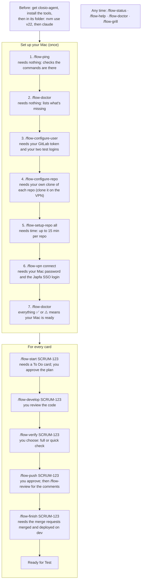
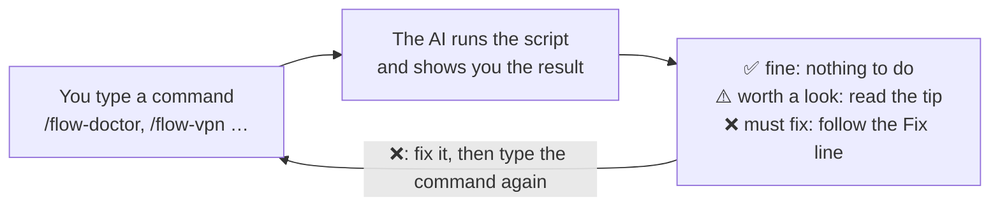
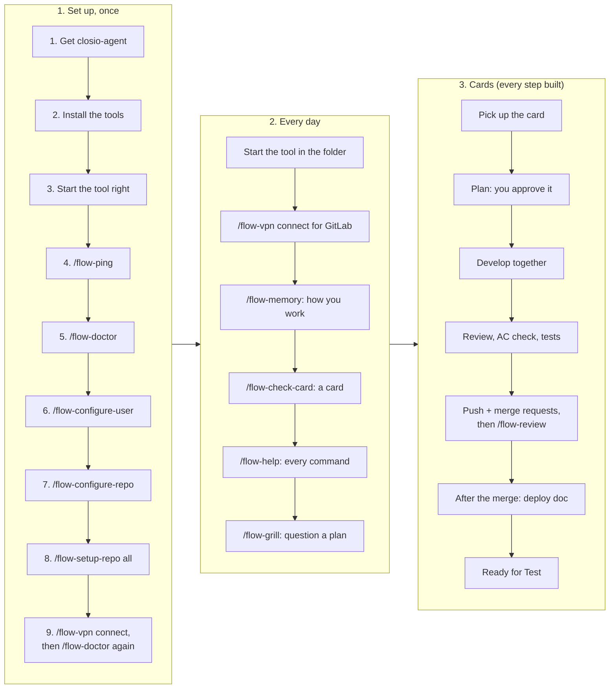
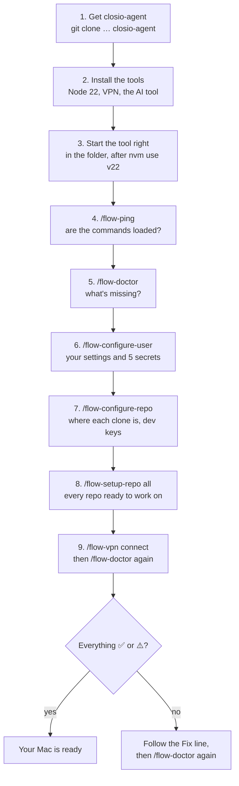
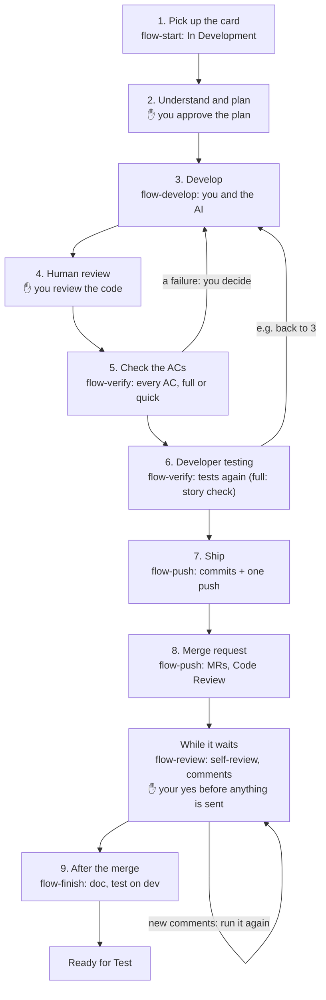

# closio-agent, step by step

**Claude artifact:** https://claude.ai/code/artifact/a83b1e2a-0e5a-4378-b791-26b9f34e8b7a · mirrored on 2026-10-19 · commands: flow-ac-check, flow-check-card, flow-configure-repo, flow-configure-user, flow-develop, flow-doctor, flow-finish, flow-grill, flow-help, flow-memory, flow-ping, flow-push, flow-review, flow-setup-repo, flow-start, flow-status, flow-verify, flow-vpn

This guide walks you through closio-agent from the first minute: which command to type, in what order, what each one asks you, and what you get back. It's written for anyone on the team, even if you've never used an AI tool before.

This file is the source and holds the full text. The Claude artifact linked above shows the same information as pictures with less text, for reading in your browser: one picture per command (when to use it, every way to type it, what you see) and flowcharts for the steps. Both are kept up to date by a rule ([section 9](#9-where-to-read-more)), and `/flow-doctor` tells you if the artifact falls behind.

## Start here

Type these in order. Each box says what the command needs from you. The details of every command come further down (in the artifact: its own picture).



## 1. What closio-agent is

closio-agent is a helper that lives in your AI tool (Claude Code or Codex). It takes a Jira card from the SCRUM board through the whole delivery flow: pick up the card, plan, develop with you, test, push with tidy commits, create the merge requests, and write the deployment doc.

Today the **setup part** is built: the commands that get your Mac ready and keep it healthy. Of the **card part**, every phase is built: the pick-up, the plan, the development, the checks, the push and the after-merge step (`flow-start`, `flow-develop`, `flow-verify`, `flow-ac-check`, `flow-push`, `flow-review`, `flow-finish`, `flow-status`; [section 6](#6-working-on-a-card)).

You never run scripts by hand. You type a command, the AI runs the right script and shows you the result. Every problem comes with the steps to fix it.

## 2. How to type a command

Every command starts with `flow-`.

| Tool | How you type it | Example |
|---|---|---|
| Claude Code | a slash, then the name | `/flow-doctor` |
| Codex | a dollar sign, then the name | `$flow-doctor` |

Some commands take a word after the name, e.g. `/flow-vpn connect`. In Claude Code, the `/` menu shows a command's options next to its name (e.g. `/flow-vpn  connect | status | disconnect`): `[…]` is optional, `|` means one of them, `<…>` is yours to fill in. Then, as soon as you type the first letter of an option, Claude Code suggests the words that fit there, read from closio-agent at that moment: the command's options, the repo names, your card keys, the items. Pick one with Tab or Enter. This works in the terminal and in the desktop app's chat, by itself, in every session started in the closio-agent folder (`flow-autocomplete`, [D73](design-decisions.md#d73)). Codex can't suggest while you type; its `$` menu shows each command's options in its one description line (e.g. `$flow-setup-repo [<repo-name>|all] [install | services | dev-address [<url>]] · Gets a registered repo ready…`; hidden in a narrow window), and `$flow-help <command>` lists them in full. This guide shows the Claude Code form; in Codex, replace `/` with `$`.

A command only runs when **you** type it. The AI never starts one by itself, with one exception: `flow-develop` also starts when you ask in plain words to develop a card whose plan is approved ("develop SCRUM-567").

Three symbols come back in every check:

| Symbol | Meaning | What you do |
|---|---|---|
| ✅ | fine | nothing |
| ⚠️ | worth a look; it doesn't stop you | read the tip, decide yourself |
| ❌ | must fix | follow the "Fix:" line under it, then run the command again |



Every command works the same way: you type it, the AI runs it and shows the result, and a ❌ sends you back with its fix.

## 3. The whole journey



You set up once, left to right; then every day you only need the middle box; and each card goes through the third box, step by step.

**One-time setup** (section 4):

1. Get closio-agent, install the tools, start the AI tool the right way.
2. `/flow-ping`, then `/flow-doctor`.
3. `/flow-configure-user`, `/flow-configure-repo`, `/flow-setup-repo all`.
4. `/flow-vpn connect`, then `/flow-doctor` again: everything ✅ or ⚠️.

**Every day** (section 5):

1. Start the AI tool in the closio-agent folder.
2. `/flow-vpn connect` when you need GitLab.
3. `/flow-memory` to tell the agent how you like to work.
4. `/flow-check-card` before a card is picked up.
5. `/flow-help` whenever you forget a command.
6. `/flow-grill` when you want a plan or an idea questioned before you go on.

**Working on a card** (section 6; every step is built):

1. `/flow-start SCRUM-567`: pick up the card.
2. Plan: the code first, your answers, your approval (part of `/flow-start`).
3. `/flow-develop SCRUM-567`: develop together (the code and its unit tests), then your review.
4. `/flow-verify SCRUM-567`: every AC checked, the full way (saved test cases, the story check) or the quick way (straight against the code); the tests again.
5. `/flow-push SCRUM-567`: your approved commits, one push per repo with the merge requests, the card to Code Review. While they wait for the merge, `/flow-review SCRUM-567`: a self-review and the reviewers' comments.
6. `/flow-finish SCRUM-567`: after the merge, the checks on dev, the deployment doc (run folder and Jira card), Ready for Test.

## 4. One-time setup, in this order



Read it top to bottom; after step 9, `/flow-doctor` decides whether you're done or have a Fix line to follow.

### Step 1: Get closio-agent on your Mac

The code is in a private GitHub repo, so ask Manas to add your GitHub account first. Then, in the folder where you keep your projects:

```bash
git clone https://github.com/manas-shurutech-04/closio_agent.git closio-agent
```

The `closio-agent` at the end names the folder the way these docs expect.

### Step 2: Install the tools

You need: Homebrew, git, nvm with Node 22, openfortivpn (the VPN), Claude Code and/or Codex (installed with npm inside Node 22), and Docker or Homebrew copies of Redis and RabbitMQ. The exact commands are in the [setup guide, section 1](setup-guide.md#1-what-you-need-before-starting).

You'll also need access to Jira (project SCRUM), the Japfa GitLab, the Japfa VPN (SSO), and your test logins for the Closio web app and the WS1 login API (your login on the **dev** WS1: every check logs in there).

### Step 3: Start Claude Code or Codex the right way

Every time, in a terminal:

```bash
cd path/to/closio-agent
nvm use v22
claude        # or: codex
```

Two rules that never change: **start in the closio-agent folder** (never inside a code repo), and **run `nvm use v22` first**. The first time, the tool asks whether you trust the folder: say yes. That lets our own scripts run without asking you for permission each time, and turns on Claude Code's suggestions while you type a flow command.

### Step 4: `/flow-ping`

- **When:** right after starting, the first time.
- **What it does:** answers whether the flow commands are loaded in this tool. It changes nothing.
- **Options:** `/flow-ping` on its own, or `/flow-ping <any text>` (the text is echoed back).
- **You see:** `flow commands are loaded in Claude Code` (or Codex).
- **If not:** the command isn't in the menu. Check that you started in the closio-agent folder; in Claude Code run `bash scripts/link-claude-skills.sh` in a terminal, then try again.

### Step 5: `/flow-doctor`

- **When:** now, and again after every fix. Also any time something feels wrong.
- **What it does:** checks your whole setup and tells you how to fix each problem. It only reads.
- **Options:** `/flow-doctor` on its own. In Codex, approve running it with network access.
- **You see:** a heading per section (Project, Tools, VPN and GitLab, Personal settings, User memory, Commands documented, Cards in progress, Checking web cards, Repos, Repo setup, Keychain, Jira), one ✅/⚠️/❌ line per check, each problem in bold with its **Fix:** or **Tip:** under it, commands in color, and at the end **Result: N to fix, M to look at.** `bash scripts/doctor.sh` in a terminal shows the same, in color (without the Jira check).
- **If ❌:** do what the "Fix:" line says, then run `/flow-doctor` again. The first time, expect ❌ for the personal settings, the Keychain items and the repos: the next steps fill them in.

### Step 6: `/flow-configure-user`

- **When:** once, after the first `/flow-doctor`. Again whenever something personal changes (e.g. a new GitLab token).
- **What it does:** sets up everything that's yours: your Jira account (found automatically), GitLab username, workspace folder, which AI tools you use, git name and email, your 5 secrets, and Playwright for checking web cards (it asks before that download: about 150 MB, about 430 MB on disk). It asks only for what's missing.
- **Options:** `/flow-configure-user` (everything that's missing), or `/flow-configure-user <item>` for one item: `jira-account-id`, `gitlab-username`, `workspace-dir`, `ai-tools`, `vpn-username` (optional, not needed), `git-name`, `git-email`, `gitlab-token`, `fe-login-id`, `fe-login-password`, `ws1-login-userid`, `ws1-login-password`, `playwright`.
- **How the secrets are asked:** never in the chat. A macOS message says which secret is next ("Copy it now, then click Continue"), then a hidden box opens: paste it there. It goes straight into your Mac's Keychain. Have your GitLab token ready ([setup guide, section 4](setup-guide.md#4-gitlab)) and your two test logins.
- **You see:** your settings with ✅/❌, and "✅ stored" for each secret. Values are never shown.
- **If ❌:** the line says which item to redo, e.g. `/flow-configure-user gitlab-token`.

### Step 7: `/flow-configure-repo`

- **When:** once per repo you'll work on. The 7 Closio repos are already registered for the team; you only tell closio-agent where your clone is and give the repo's dev keys.
- **Before it:** clone the repo yourself, on the VPN (`/flow-vpn connect`, then `git clone <GitLab address> <your workspace folder>/<repo>`). closio-agent never clones.
- **What it does:** with a repo name, records where your clone is and asks for that repo's dev keys (for WS1: its own client ID and secret, which it sends to the WS2s and which the checks send on direct WS2 calls; a WS2 needs no keys of its own; database user and password are optional). With a path to a clone of a new repo, registers that repo for the whole team (the AI suggests every value from the repo, you confirm or change them, and the new file is committed so everyone gets it).
- **Options:** `/flow-configure-repo` (list the repos and their state on your Mac); `/flow-configure-repo <repo-name>` (set up a registered repo on your Mac); `/flow-configure-repo <full path of a clone>` (register a new repo); `/flow-configure-repo <repo-name> key <name>` (add or replace one dev key); `/flow-configure-repo <repo-name> path <full path | not-cloned>` (change where the clone is).
- **You see:** the repo's facts and ✅/⚠️ per item. Missing dev keys show ⚠️, not ❌: they're only needed to test that repo on the dev environment.

### Step 8: `/flow-setup-repo`

- **When:** once per repo after step 7 (`all` does every repo you've cloned), and again after a big change in the repo.
- **What it does:** gets the repo ready to work on: switches to the repo's own Node version (installs it if missing), installs the packages when needed, finds or starts the local Redis and RabbitMQ (Homebrew or Docker), checks that the repo's `.env` has every variable and points to those local copies (it never shows a value: if something is off, it opens the file for you with the lines to set), runs the tests once, and gives the AI tool access to the repo folder. It never changes branches and needs no VPN.
- **Options:** `/flow-setup-repo` (each repo's setup state); `/flow-setup-repo <repo-name>`; `/flow-setup-repo all`; add `install` to force a reinstall of the packages; add `services` to choose Homebrew or Docker again for Redis and RabbitMQ; `/flow-setup-repo <repo-name> dev-address` (or `… dev-address <url>`) sets or changes only that repo's dev address, and `/flow-setup-repo all dev-address` every repo's at once.
- **You see:** one block per repo (clone, Node, env file, packages, local services, `.env` check, tests, folder access) and a result line. If the repo's address on the dev environment isn't saved yet, the AI asks you for it (once, for the whole team: it goes in the shared repo file; `/flow-finish` uses it). With `dev-address`, only that is done, in seconds: you see the old and the new address, and a reminder to commit the shared repo file. It can take a while (tests up to 15 minutes per repo). macOS dialogs may appear when you have to choose something.
- **If ⚠️ on `.env`:** the file is open in your editor with the exact lines to set. Change it yourself, save, run the command again. In Codex, start it again with the `codex --add-dir …` command shown at the end, so it can use the repo folders.

### Step 9: `/flow-vpn connect`, then `/flow-doctor` again

- **What it does:** connects the Japfa VPN (one macOS password dialog, then the SSO login in your browser if it asks). The VPN stays on until you disconnect it. GitLab and the dev servers are only reachable on the VPN.
- **Then:** run `/flow-doctor` once more. Everything should be ✅ or ⚠️. If it is, your Mac is ready.

## 5. Every day

### `/flow-vpn`

- **Options:** `/flow-vpn connect` (does nothing if GitLab already answers, e.g. through the FortiClient app), `/flow-vpn status` (only reads), `/flow-vpn disconnect`.
- **Good to know:** the certificate pin expires on 2027-02-03; if the gateway's certificate changes, the command shows the new fingerprint to confirm with IT.

### `/flow-memory`

- **What it is:** your private memory: short notes on how you like to work (e.g. "write plans as short numbered steps"). Every command reads them first and follows them. They stay on your Mac and are never pushed. Team rules always win over them.
- **Options:** `/flow-memory` (list); `/flow-memory add <text>` (everywhere); `/flow-memory add <repo> <text>` (one repo only); `/flow-memory edit <id> <new text>`; `/flow-memory edit <id> phases <phases>`; `/flow-memory remove <id>`; `/flow-memory clear` (all, after showing them and asking); `/flow-memory clear <repo>`.
- **Also:** when you correct the AI during a command, it offers once to save the correction here. It saves only after you say yes. Your memory can also answer three repeat questions for you (section 6, "Make it ask you less"). It can't switch off the way decisions are asked during a card (section 6, "How it asks you things"): that's a team rule.

### `/flow-check-card`

- **When:** before a card is picked up, to see whether it follows the team's card template ([jira-card-template.md](jira-card-template.md)).
- **Options:** `/flow-check-card SCRUM-567` (the card from Jira; its text is saved privately in `local/cards/`), or `/flow-check-card local/cards/my-draft.md` (a card that isn't in Jira yet).
- **You see:** ✅/⚠️/❌ lines (required sections, AC format, QA steps, placeholders, forbidden tables, secrets), a line about the card type (a Spike isn't picked up; a Bug may have gaps you explain at pick-up), and "Ready" or "Not ready". It never changes the card in Jira.

### `/flow-help`

- **Options:** `/flow-help` (every command, grouped, with how it's typed), `/flow-help <command>` (one command in full, e.g. `/flow-help memory`).
- **You see:** a heading per group, each command's name in bold with one line on what it does, and every way to type it on its own line.
- **Good to know:** the help is read from the commands' own files, so it's always complete. `bash scripts/help.sh` in a terminal shows the same, in color.

### `/flow-grill`

- **When:** you want a plan, an idea or a card questioned before you go on. (While a card command runs, it already asks you this way by itself: section 6.)
- **Options:** `/flow-grill "<your plan or idea>"` (the answers stay in the chat, with a summary at the end), `/flow-grill SCRUM-567` (a card you've picked up: its folder and the code are read, and the answers are saved in its `decisions.md`; a card not picked up yet: it's read from Jira and the answers stay in the chat).
- **You see:** first what it found by itself ("Found" lines, each saying where), then numbered questions in rounds, each with a recommended answer: "yes" accepts it, "yes to all" the whole round, or answer by number. Follow-up rounds until nothing is open, then what you agreed, for your confirmation.
- **Good to know:** it only reads; it never changes code, Jira or GitLab. Adapted from Matt Pocock's "grill me" (MIT licence); the method is in `rulesets/grilling.md`.

## 6. Working on a card

Every step is built: picking a card up, planning it, developing it with you, checking it, pushing it with its merge requests, and finishing it after the merge.

**Words you'll see**

- **The card's folder** (`runs/SCRUM-567/`): where closio-agent keeps a card's notes: the card, the plan, what was built and checked, and its history.
- **The card's saved copy** (the branch `runs/SCRUM-567`): that folder saved on GitHub, so you or a teammate can carry on from another Mac. It never goes into `main`.
- **Where a card stands:** being picked up · planning · in development · being checked · ready to push · waiting for the merge · finished.
- **Full or quick check:** the two ways `/flow-verify` checks a card: full saves test cases and runs them; quick checks each AC directly against the running code.
- **MR:** a merge request on GitLab.
- **Found:** a line with something the agent found by itself (in the card, its folder or the code), with where it found it; it never asks you those.
- **Decision 3:** a pointer to row 3 of the card's `decisions.md`, where every decision is written in full.

**How it asks you things.** While a card command runs, every question is asked the same way (the "grilling" way, `rulesets/grilling.md`): what the agent can find in the card, its folder or the code, it shows you as "Found" lines and never asks; only real decisions are asked, numbered, in rounds, each with a recommended answer ("yes" accepts it, "yes to all" the round); follow-up rounds until nothing is open; then a summary of what you agreed, and nothing changes before you confirm. The same happens when you ask for a change in the middle of a command (e.g. "also return the partner name"); short answers, approvals and your questions go straight. The safety stops (a migration, test data, the commits, the push, a Jira move) still ask their own plain yes or no.

**Every decision is written down.** Each card's folder has `decisions.md`: one numbered row per decision, from pick-up to Ready for Test (when, at which step, the question, what was decided, and who: you, your memory, or the recommendation you accepted). Your approvals at the safety stops are in it too. The card's other files only point to it ("decision 3"), so there's one place to see why the card was built the way it was.

**Make it ask you less.** The commands stop before anything that matters: the plan, test data, the commits, the push, a migration. Three questions can be answered by your memory instead, once and for all:

- full or quick check: `/flow-memory add Always use the quick check in flow-verify`
- your MR reviewers and labels: `/flow-memory add My MR reviewers are ana.s and budi`
- standing notes for the deployment doc: `/flow-memory add Deployment doc: deploy WS2 repos one at a time`

The command then says in one line which entry it used, and you can still say otherwise.

**Long steps say how long.** Before a step that takes a while, the AI says what it's doing and roughly how long it takes, from real runs (e.g. "Writing the test cases: about 12 minutes for 26 cases on a web card").



The ✋ boxes are where the agent stops and waits for you. A failed AC check or test is shown to you with a suggestion, and you decide what's next (for example, back to Develop). While the merge requests wait, `/flow-review` can run as often as reviewers comment.

### `/flow-start`

- **When:** to pick up a card that's To Do and plan it. Run it again any time to continue where it stopped (if it stopped while planning, it reads the latest code again first).
- **What it does, in order:** the VPN; the card read from Jira and checked against the template (a Spike stops; a card that isn't To Do or belongs to someone else: it asks); into the sprint, **In Development**, assigned to you; the repos it needs, confirmed by you; a branch `SCRUM-<n>/<short-description>` in each repo, the name confirmed by you; everything saved. Then the plan: **the latest code is brought into the new branches and read first**, together with **the team's ruleset** (`rulesets/story-implementation-workflow.md`; your memory can change its points for you), **every difference between the card and the code is asked about** the grilling way (what the code answers shown as found; the rest in rounds, a recommended answer each, until nothing is open), the draft plan is shown, **you approve it**, and only then it's saved.
- **Options:** `/flow-start SCRUM-567` only.
- **You see:** one line per step, each written into the card's `history.md` with the rules and memory it applied; the questions and the plan in chat; at the end `Done: SCRUM-567 is planned. Next: /flow-develop SCRUM-567`, or say "develop SCRUM-567".
- **Where it's remembered:** `runs/SCRUM-567/` (`state.md`, `history.md`, `card.md`, `plan.md`, and `decisions.md`: every decision on the card) saved to the branch `runs/SCRUM-567` of closio-agent and pushed after every phase, never on `main`; your closio-agent folder itself always stays on `main`. A teammate can pull that branch and continue.
- **If ❌:** the line says what to do (connect the VPN, fix the card, commit or stash a repo's changes, give folder access). Then run it again.

### `/flow-develop`

- **When:** once the plan of a card is approved (`/flow-start` ends with "Next: /flow-develop"). Run it again any time to continue where it stopped, on the same Mac. Also after a failed check: if `/flow-verify` found failures, it shows them and asks whether to go back to development and fix them.
- **Plain words work too:** "develop SCRUM-567" starts it, but only for a card whose plan is approved (you name it, or it's the only card waiting to be developed).
- **What it does, in order:** the VPN; your repos on the card's branch, with the latest base branch; then, repo by repo in the plan's order: **the code** (copying how the closest existing files do it, reusing what the repo already has instead of writing it again, creating new files where needed, and **asking you first** about anything new or different from the plan), **the unit tests** (run with the coverage gate until they pass), **the repo's checks** (lint only looks at the files the card changed and only warns; other checks must pass), and migrations or seeders **only after you've reviewed them and said yes**; a short summary after each repo, then it goes straight on. At the end it shows everything for **your review**: you look at the changes in your editor and say "review approved", or what to change.
- **Options:** `/flow-develop SCRUM-567` only (or the plain words).
- **You see:** a line per step, the questions when something isn't in the plan, a summary per repo, the review, and at the end `Done: SCRUM-567 is developed and reviewed. Next: /flow-verify SCRUM-567`.
- **Where it's remembered:** `runs/SCRUM-567/develop.md` (what was built per repo, the tests, everything not in the plan with your answers, the review; every decision in full in `decisions.md`). The code stays uncommitted in your repos until the push, so continue on the same Mac.
- **If ❌:** the line says what to do (a test or a check to fix, Node to install, folder access, uncommitted changes). Then run it again.

### `/flow-verify`

- **When:** after `/flow-develop` ends with "review approved". Run it again after a fix.
- **Two ways, you pick:** it asks which one (or type `full` / `quick` after the key):
  - **A — Full check:** writes and saves the **test cases** of every AC (API checks for the backend, Playwright tests for the web app; from your QMetry export when you give one, otherwise from the card and the code), runs them, runs the repo tests again and checks the build against the story.
  - **B — Quick check:** checks every AC straight against the running code: the statuses, error codes, messages and response structure it returns. After a call that writes, it reads the database to check what was written. No test cases are saved, no QMetry, no story check; the repo tests run again. Faster, and fewer tokens.
- **Web cards, both ways:** before any test is written it lists the APIs the card's screens call and asks you which are available on dev right now (every run). One that isn't is mocked: you send its exact 200 response once. Right before the run it checks the GET APIs on dev, and asks again about one that doesn't answer. `verify.md` says which APIs were real and which were mocked.
- **Both ways:** it starts the card's repos on your Mac; if the checks need **test data** or send calls that **write** (POST, PUT, PATCH, DELETE), it shows you those and their cleanup first and runs them only after your yes; at the end it cleans up after your yes and stops the servers.
- **Options:** `/flow-verify SCRUM-567` (it asks A or B), `/flow-verify SCRUM-567 full`, `/flow-verify SCRUM-567 quick`, or `/flow-verify SCRUM-567 full ~/Downloads/<QMetry export>.xlsx` when you have the card's QMetry test cases. QMetry is optional, only for A, and never asked for: with an export its cases are the base; without one the test cases are written from the card and the code.
- **You see:** ✅ / ❌ per AC and per case or scenario, the repo tests, and (A) the story check. With a QMetry export (A), also one line: how many of its test cases were covered (e.g. `QMetry: 18 of 22 test cases covered (82%)`). All ✅: `Done: SCRUM-567 is verified. Next: /flow-push SCRUM-567`. Something ❌: each failure with a suggestion (fix the code with `/flow-develop`, change a test case with `/flow-ac-check` for A, or a setup fix), and **you decide** what to do.
- **Where it's remembered:** every decision in `runs/SCRUM-567/decisions.md`; `runs/SCRUM-567/verify.md` records **every run** (what was tested and the results, newest first, never overwritten); A's test cases in `runs/SCRUM-567/api-checks/` or `runs/SCRUM-567/e2e/`. B's one-off files stay on your Mac only and are removed at the end.
- **Good to know:** web cards need Playwright (`/flow-configure-user playwright`). Your logins and keys are added by the scripts and never shown.

### `/flow-ac-check`

- **When:** you want a new test case for an AC, a case changed, or an AC's cases written again.
- **Options:** `/flow-ac-check SCRUM-567 3` (AC 3's cases written again from the card and the code), `/flow-ac-check SCRUM-567 3 "add a case for ?status=foo"` (added or changed as you say).
- **You see:** first the VPN, if it's off (the checks log in on dev); for a web card, then the question which of the AC's APIs are available on dev; then what changed in the AC's cases, then that AC's result. Test data or calls that write, if needed, only after your yes. The run is recorded in `verify.md`. The next `/flow-verify` (full check) runs it with the rest.


### `/flow-push`

- **When:** after `/flow-verify` says the card is verified.
- **What it does, in order:** brings each repo up to the latest base branch (your uncommitted work is put aside, the branch rebased, your work put back; a conflict waits for you to fix it in your editor); runs the repo's tests again; proposes the **atomic commits**, each layer's code with its own tests, messages like `SCRUM-567: Add the ageing config model`, and **you approve the list**; makes them (in the repos with husky, the coverage gate runs on every commit, so it takes a while); prepares each **merge request**: title `SCRUM-567: <card title>`, into the repo's MR branch, assigned to you, the labels and reviewers you confirm, and a short description (the Jira link, the migrations and seeders to run); shows you everything and pushes **only after your yes**, once per repo; then sets each MR's description and reviewers, checks the card shows the MRs (adds a comment if one is missing) and moves the card to **Code Review**.
- **Options:** `/flow-push SCRUM-567` only. Run it again to continue where it stopped (e.g. after a conflict).
- **You see:** the files per repo, the commit list to approve, the MRs to approve, then the MR links and `Done: SCRUM-567 is pushed and in Code Review.`, with what comes next: `/flow-review SCRUM-567` while the MRs wait, `/flow-finish SCRUM-567` once they're merged.
- **Where it's remembered:** `runs/SCRUM-567/ship.md` (the commits, the pushes, the MR links), each MR's description in `runs/SCRUM-567/mr-<repo>.md`, every decision in `decisions.md`.
- **Good to know:** a push is never forced, and the repos' git hooks always run. Your GitLab token is read from the Keychain by the script and never shown.

### `/flow-review`

- **When:** after `/flow-push`, while the merge requests wait for the merge: once to review your own code before the reviewers look, and again whenever reviewers comment.
- **What it does, in order:** the VPN; each MR's state (who approved, merge conflicts, the pipeline and any failed job); a **self-review** of the card's code (the story: every AC covered by code and tests; the basics: no function written again that already exists, each piece in the right file, no unused or debug code, no hard-coded values, tests for the new branches) plus the tool's own reviewer; the findings shown to you in chat (never on the MR) and the ones you choose fixed and tested; then the reviewers' **new comments**: a drafted reply for a question, a tested fix and a reply for a change request, your call for the rest. Then **your yes**, the fixes pushed into the same MR (new commits on top, never forced, no rebase), the replies posted as you.
- **Options:** `/flow-review SCRUM-567` (a full run), `/flow-review SCRUM-567 check` (only lists what's new: comments, approvals, the pipeline, conflicts; changes nothing, so you can repeat it, e.g. `/loop 30m /flow-review SCRUM-567 check` in Claude Code).
- **You see:** the MRs' state per repo, the findings (must fix / should fix / small), each comment with its drafted reply or fix, the commits and replies to approve, then what was pushed and posted.
- **Good to know:** at most 3 self-review rounds per run and 2 tries per failing fix, so it never loops; then it's your call. It never resolves a thread (the reviewer does) and never moves the Jira card (it stays in Code Review). Every round is in `runs/SCRUM-567/review.md`, every decision in `decisions.md`.


### `/flow-finish`

- **When:** after the card's merge requests are merged and the card is deployed on dev.
- **What it does, in order:** checks every MR is merged (it stops if one is still open); asks you whether the card is deployed on dev (nothing checks it by itself); checks every AC **on dev**, the quick way (test data or calls that write only after your yes); asks if there's anything special for the deployment doc; writes the **deployment doc** in plain words, in two parts: **for QA**, what the card adds and how to try it (an API card: ready-to-run curls, with placeholders for your login and keys; a web card: the menu path to the screen; a consumer card: what to look for), and what was already checked on dev; **for the person deploying**, the order with each MR, the database changes and default data in words (by file name; you review the files first), new settings and after-deploy steps. No code in it, except the API curls; puts the doc on the Jira card as one comment; moves the card to **Ready for Test**.
- **Options:** `/flow-finish SCRUM-567` only. Run it again to continue (e.g. once an MR is merged, or once it's deployed).
- **You see:** the merge check, the dev checks per AC, the migrations to review, then `Done: SCRUM-567 is in Ready for Test.`
- **Where it's remembered:** `runs/SCRUM-567/deployment.md`, the dev check as a new run in `verify.md`, every decision in `decisions.md`; the card's saved copy (its branch) stays as its record.
- **Good to know:** each repo's dev address comes from its repo file (`/flow-setup-repo <repo-name> dev-address` sets it). A failure on dev is shown with a suggestion, and you decide.

### `/flow-status`

- **When:** any time you want to know where a card stands, or which cards are in progress.
- **Options:** `/flow-status` (every card, on this Mac and pushed by teammates), `/flow-status SCRUM-567` (that card: where it stands in plain words, what to type next, its Jira status and branch).
- **Good to know:** it only reads.

| Phase | What happens | Command |
|---|---|---|
| 1. Pick up | the card is checked against the template, moved to In Development and assigned to you; branches are created in every repo the card needs | `flow-start <CARD-KEY>` (built) |
| 2. Understand and plan | the AI reads the code on the branches first, asks you about every difference with the card, writes the plan with your memory applied; **you approve the plan** before it's saved | part of `flow-start` (built) |
| 3. Develop | you and the AI develop together, following the plan: the code and its unit tests, the repo's tests and checks | `flow-develop <CARD-KEY>` (built); it also starts when you ask in plain words, once the plan is approved |
| 4. Human review | you review the changes in your editor | part of `flow-develop` (built) |
| 5. Check against the ACs | every AC checked with its test cases (API checks for the backend, Playwright for the web app) | `flow-verify <CARD-KEY>` (built) |
| 6. Developer testing | the repo tests again (written in step 3) and a story check; a failure is shown to you with a suggestion, and you decide | part of `flow-verify` (built) |
| 7. Ship | rebase, atomic commits you approve, one push that also creates and assigns the merge requests | `flow-push <CARD-KEY>` (built) |
| 8. Merge request | the MRs' description and reviewers set; the MRs shown on the card; card to Code Review; then, while they wait for the merge, a self-review and the reviewers' comments | part of `flow-push` (built); `flow-review <CARD-KEY>` (built) |
| 9. After the merge | the merge checked, every AC checked on dev, the deployment doc (run folder and Jira card), card to Ready for Test | `flow-finish <CARD-KEY>` (built) |
| Any time | where a card stands; every step is remembered in `runs/<CARD-KEY>/`, so a card can be paused and picked up again | `flow-status <CARD-KEY>` (built) |

The full design is in [architecture.md](architecture.md).

## 7. Every command and its options

Every flow command that exists is in this table. That's a rule: a new command isn't done until it's here, in `/flow-help` and in the Claude artifact.

| Command | What it does | How to type it |
|---|---|---|
| [`flow-ping`](commands.md#flow-ping) | Are the flow commands loaded in this tool? | `/flow-ping` · `/flow-ping <any text>` |
| [`flow-doctor`](commands.md#flow-doctor) | Checks your setup and shows how to fix each problem | `/flow-doctor` |
| [`flow-configure-user`](commands.md#flow-configure-user) | Your personal settings and your 5 secrets | `/flow-configure-user` · `/flow-configure-user <item>` |
| [`flow-configure-repo`](commands.md#flow-configure-repo) | Registers a repo, or sets it up on your Mac | `/flow-configure-repo` · `/flow-configure-repo <repo-name>` · `/flow-configure-repo <path of a clone>` · `/flow-configure-repo <repo-name> key <name>` · `/flow-configure-repo <repo-name> path <full path \| not-cloned>` |
| [`flow-setup-repo`](commands.md#flow-setup-repo) | Gets a repo ready to work on, or sets its dev address | `/flow-setup-repo` · `/flow-setup-repo <repo-name>` · `/flow-setup-repo all` · add `install` or `services` · `/flow-setup-repo <repo-name> dev-address [<url>]` · `/flow-setup-repo all dev-address` |
| [`flow-vpn`](commands.md#flow-vpn) | The Japfa VPN | `/flow-vpn connect` · `/flow-vpn status` · `/flow-vpn disconnect` |
| [`flow-memory`](commands.md#flow-memory) | Your private memory, followed by every command | `/flow-memory` · `/flow-memory add <text>` · `/flow-memory add <repo> <text>` · `/flow-memory edit <id> <new text>` · `/flow-memory edit <id> phases <phases>` · `/flow-memory remove <id>` · `/flow-memory clear` · `/flow-memory clear <repo>` |
| [`flow-check-card`](commands.md#flow-check-card) | Checks a Jira card against the card template | `/flow-check-card SCRUM-567` · `/flow-check-card <file.md>` |
| [`flow-help`](commands.md#flow-help) | Every command and how it's typed | `/flow-help` · `/flow-help <command>` |
| [`flow-grill`](commands.md#flow-grill) | A plan, an idea or a card questioned with you, in rounds, until nothing is open | `/flow-grill "<plan or idea>"` · `/flow-grill <CARD-KEY>` |
| [`flow-status`](commands.md#flow-status) | Where a card stands, or every card in progress | `/flow-status` · `/flow-status <CARD-KEY>` |
| [`flow-start`](commands.md#flow-start) | Picks up a card and plans it, up to your approval of the plan | `/flow-start <CARD-KEY>` |
| [`flow-develop`](commands.md#flow-develop) | Develops a planned card with you, then your review | `/flow-develop <CARD-KEY>` · or in plain words: "develop <CARD-KEY>" |
| [`flow-verify`](commands.md#flow-verify) | Checks a developed card, A full check or B quick check: every AC, the tests (A: the story) | `/flow-verify <CARD-KEY> [full\|quick] [<QMetry export.xlsx>]` |
| [`flow-ac-check`](commands.md#flow-ac-check) | Adds or changes the test cases of one AC | `/flow-ac-check <CARD-KEY> <AC>` · `/flow-ac-check <CARD-KEY> <AC> "<what to change>"` |
| [`flow-push`](commands.md#flow-push) | Ships a verified card: your approved commits, one push per repo with the MRs, Code Review | `/flow-push <CARD-KEY>` |
| [`flow-review`](commands.md#flow-review) | While the MRs wait for the merge: their state, a self-review of the code, the reviewers' comments | `/flow-review <CARD-KEY>` · `/flow-review <CARD-KEY> check` |
| [`flow-finish`](commands.md#flow-finish) | After the merge: every AC checked on dev, the deployment doc (run folder and Jira card), Ready for Test | `/flow-finish <CARD-KEY>` |

Codex: the same commands with `$` instead of `/`.

## 8. When something goes wrong

- Read the "Fix:" line under the ❌. It's written to be followed as it is. Then run the command again.
- `/flow-doctor` is the first thing to try when you don't know what's wrong.
- The AI never fixes your Mac, your secrets or your `.env` files by itself; it tells you what to change and you change it.
- Never paste a password, token or `.env` content into the chat. If it happens, change that secret.
- Still stuck: ask Manas, with the command you typed and the lines you got back.

## 9. Where to read more

| Doc | Read it when |
|---|---|
| [setup-guide.md](setup-guide.md) | you install the tools, the VPN, your secrets, the repos; every manual step as a backup |
| [commands.md](commands.md) | you want every detail of a command |
| [jira-card-template.md](jira-card-template.md), [jira-card-examples.md](jira-card-examples.md) | you write or check a card |
| [architecture.md](architecture.md) | you want to see the whole flow and what comes next |
| [agent-rules.md](agent-rules.md) | you want the rules the agent always follows |
| [design-decisions.md](design-decisions.md) | you want to know why something is the way it is |
| [the rulesets](../rulesets/): [story-implementation-workflow.md](../rulesets/story-implementation-workflow.md), [grilling.md](../rulesets/grilling.md), [code-review.md](../rulesets/code-review.md) | you want the team's way of building a card, of asking for decisions, and of reviewing code |


One change to a command fans out to four places, and `/flow-doctor` won't go green until all four are done.

**How this guide stays up to date.** `docs/user-guide.md` is the source. Whenever a flow command is added or changed, the same step adds it to that command's own `## Usage` block (and its options to the `argument-hint` line Claude Code's `/` menu shows) and to a group in `/flow-help`, to `commands.md`, to this guide, and updates the Claude artifact from this file (there, each command is a picture, redrawn when the command changes), with the "mirrored" line at the top set to the date and every command. That's rule R17 for whoever builds closio-agent, and rule 11 in `AGENTS.md` for the AI. `/flow-doctor` runs the check ("Commands documented") and shows ❌ until it's done. Only Claude Code can update the artifact; a change made in Codex is finished in Claude Code.

And whenever anything changes (a command, a script, a setting, a rule), the rule files (the rulesets, `AGENTS.md`, the agent rules, the pre-approvals) and every status line ("built", "tested by the user") change with it, in the same step: rule 21 in `AGENTS.md`. `/flow-doctor` also shows ❌ while a rule file still calls a built command "coming" or "not built yet".
